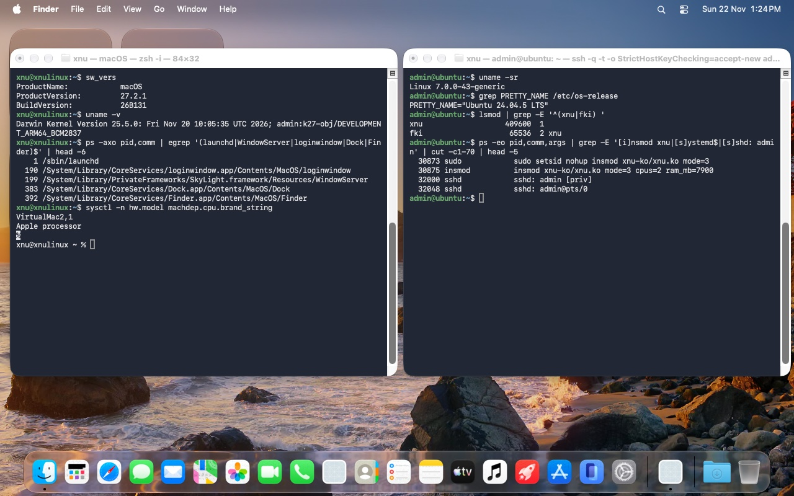
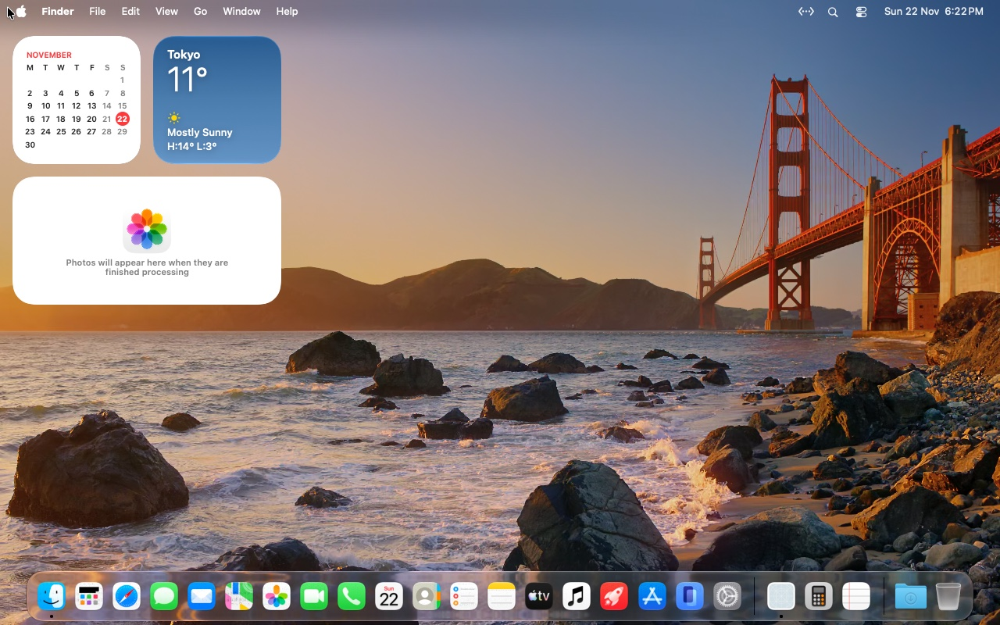
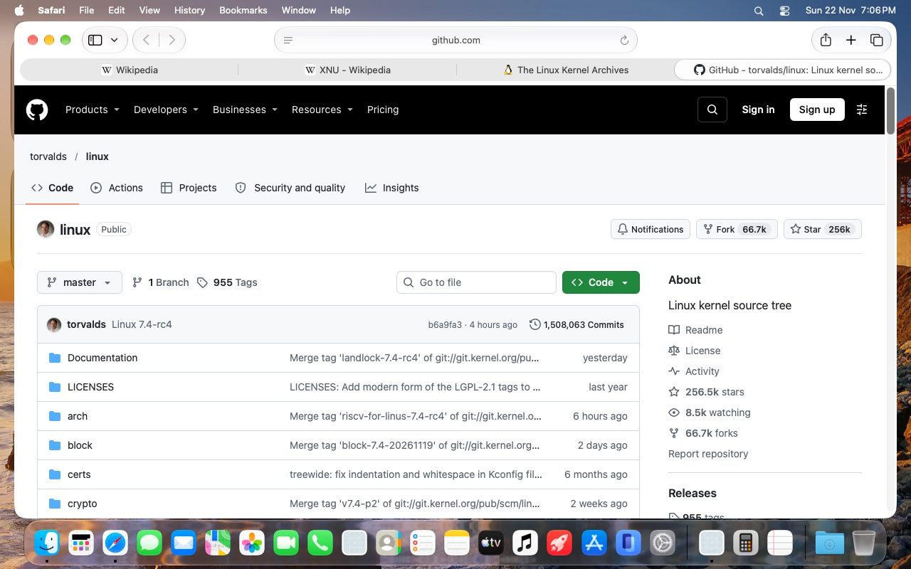

**Idiomas:** [English](README.md) | [Português](README.pt.md) 

# xnulinux

Rode o userspace do macOS no Linux carregando o kernel do macOS dentro dele.

O xnulinux compila o XNU, o kernel open-source do macOS, a partir de fontes publicadas pela Apple e o executa como um módulo carregável do kernel (`xnu.ko`) dentro de um kernel Linux arm64 sem modificações. O XNU hospedado controla a CPU e a MMU diretamente, fazendo com que os processos do macOS rodem de forma nativa lado a lado com os processos do Linux nas mesmas CPUs, sem nenhum hypervisor entre eles. O Linux empresta ao XNU sua memória, timers, arquivos, rede e GPU por meio de um pequeno módulo de interface (`fki.ko`).


Com um kernel stock do Ubuntu, o comando `insmod xnu.ko` inicializa um disco do sistema do macOS 27 gerado pelo próprio instalador da Apple diretamente ao desktop: loginwindow, WindowServer, Dock, Finder, Safari e Chrome.



*Um sistema, dois userspaces. À esquerda: um Terminal no macOS 27.2.1 hospedado (`sw_vers`, o kernel Darwin, launchd, WindowServer, Dock e Finder em execução). À direita: a partir desse macOS, uma sessão SSH conectada ao Linux dentro do qual ele roda (Ubuntu, Linux 7.0, os módulos `xnu` e `fki` carregados e o processo `insmod xnu.ko` no qual o kernel do macOS é executado). Diretamente do framebuffer hospedado, 1280×800.*



*O desktop hospedado ao final de uma stress run de 30 minutos, renderizado na CPU (sem GPU bridge).*

| | |
|---|---|
|  |  |
|  | |

*Safari no macOS hospedado: artigo da Wikipedia sobre o XNU, kernel.org e o repositório Linux no GitHub, via o link de rede do sistema hospedado através do Linux, com a ponte GPU ativada (`GPU=auto`).*


*NVIDIA DGX Spark no modo bare-metal (Ubuntu 24.04.5 LTS aarch64, Linux 7.0.0-1025-nvidia): macOS 27 hospedado rodando com 4 CPUs e 8 GiB de RAM (renderização via CPU), exibido através do macOS Screen Sharing ao lado de uma sessão SSH do host DGX Spark para o userspace Darwin hospedado.*


*Dentro do macOS hospedado no DGX Spark: Sobre Este Mac (`Chip: Unknown`, `7.80 GB` de memória, `macOS Golden Gate 27.2`) ao lado de `sysctl machdep.cpu` (`ARM processor`, `hw.cpufamily: 0`, `hw.ncpu: 4`) e `hw.optional.arm`.*

## Como funciona 

```
 Processos do macOS (launchd, WindowServer, Safari...)  Processos do Linux (systemd, sshd, xnudrmd...)
 ──────────────────────────────────────────────────    ────────────────────────────────────────────
XNU (compilado do código-fonte, camada LINUX64, kexts) │
   ↕ chamadas ao host linux64 (xnu-patches/include/linux64_abi.h)
 xnu.ko   (lado APSL: carrega e executa a kernel collection)
   ↕ FKI, a foreign kernel interface (fki_*)
 fki.ko   (lado GPL: CPUs, memória, faults, IPIs, arquivos, rede, host calls)
 Kernel Linux (kernel stock da distro, páginas 4K, PAC)
```

- **CPUs**: cada CPU hospedada é uma kernel thread do Linux fixada a uma CPU do Linux. O XNU roda nela até fazer uma chamada ao host (idle, I/O, um timer); o Linux mantém seus próprios exception vectors, e o `fki.ko` encaminha os faults e as exceções de usuário do código do XNU para os handlers do XNU.
- **Memória**: o XNU recebe um único bloco fisicamente contíguo do Linux (CMA) e o gerencia com seu próprio pmap; o XNU e o Linux compartilham a metade de usuário do layout do espaço de endereçamento (páginas de 4K).
- **Dispositivos**: as kexts em `kexts/` fornecem ao macOS um disco (um arquivo no lado do Linux), uma tela (um framebuffer que o Linux lê), um teclado e ponteiro, um link Ethernet (uma interface de rede do Linux), um keystore e uma GPU bridge.
- **GPU**: o Metal no macOS hospedado roda sobre o `gpu/xnu-cpu-metal` (metal2vulkan sobre Vulkan). O Vulkan acessa a GPU do host Linux através da DRM bridge (`kexts/XnuDrm` → chamada ao host → `gpu/xnu-drm/xnudrmd` → o render node do Linux), usando o driver Venus do Mesa; sem um backend de DRM bridge compatível, ele faz fallback para o lavapipe do Mesa na CPU.

## Status

Funcionando em dois setups Linux arm64:

**Mac com Apple Silicon em uma VM Linux arm64 (`krunkit`, de 1 a 6 CPUs hospedadas)**:
- O macOS 27.2.1 inicializa até a área de trabalho com login automático em 31–48 s (uma VM macOS usando Apple Virtualization no mesmo Mac: 49 s).
- Os aplicativos abrem e fecham, o Spotlight e o sistema de arquivos funcionam; um teste de estresse de 30 minutos (40 rodadas de Safari, Notes, Calculator, TextEdit, System Settings, Spotlight e uma varredura de disco) termina sem nenhum panic e sem nenhum crash report.
- Roda como um serviço systemd: iniciado no boot, encerrado de forma limpa junto com a VM, reiniciado após um panic do kernel hospedado, com o log de cada execução mantido em `/var/log/xnulinux/`.
- A GPU bridge fornece aos aplicativos hospedados a GPU do host (`Virtio-GPU Venus (Apple M5 Max)`) e vem ativada por padrão (`GPU=auto`) quando um render node virtio-gpu está presente, fazendo fallback para renderização via CPU (`GPU=off`) caso contrário.
  - **NVIDIA DGX Spark no modo bare-metal (Ubuntu 24.04.5 LTS aarch64, Linux `7.0.0-1025-nvidia`)**:
  - Inicializa até a área de trabalho completa do macOS (Screen Sharing e SSH funcionando) diretamente no Linux arm64 no modo bare-metal com `CPUS=4` e 8 GiB de RAM reservados para o XNU.
  - Atualmente faz a renderização na CPU (Mesa lavapipe, `GPU=off`): hoje o `xnudrmd` encaminha apenas ioctls do `virtio-gpu` (Venus), portanto o pass-through de GPU por hardware na GPU GB10 exige um novo backend da DRM bridge.
 
A entrega como um serviço hospedado (o que é distribuído e o que o usuário instala para executar o macOS da Apple) está documentada em [`docs/hosted-service.md`](docs/hosted-service.md).

O que ainda é uma solução provisória está listado em [`docs/production.md`](docs/production.md). Em destaque: o cryptex do sistema operacional é mesclado ao volume do sistema, o AMFI recebe patches e o SIP é flexibilizado, além de o acesso à memória ser mais lento do que em uma VM nativa (páginas de 4K contra 16K).

## Requisitos

- Um host Linux arm64 com PAC (`FEAT_PAuth`), páginas de 4K e pelo menos 16 GB de RAM (8 GB reservados para o kernel hospedado). Testado em:
  - **NVIDIA DGX Spark** (Ubuntu 24.04.5 LTS aarch64 no modo bare-metal, Linux `7.0.0-1025-nvidia`; renderização via CPU por enquanto).
  - **Mac com Apple Silicon (M1 ou posterior)** rodando uma VM Linux arm64 (`krunkit` para acesso à GPU via virtio-gpu Venus, ou `tart`).
- Um Mac com Xcode para criar o disco do sistema e compilar os componentes da GPU.
- Uma instalação própria do macOS 27 (um disco de VM do Apple Virtualization). **Nenhum binário da Apple está neste repositório ou é distribuído por ele**: as kexts fornecidas pela Apple, o disco do sistema macOS e seu trust cache vêm da sua própria instalação.

## Compilação e execução

1. `scripts/vm-xnu-build.sh` (no host Linux arm64, uma única vez): configura a toolchain Linux do macOS-DroidVM e compila o XNU (`xnu-12377.121.6`) nativamente em arm64.
2. `scripts/vm-xnu-rebuild.sh`: aplica os patches de `xnu-patches/`, compila o kernel e as `kexts/`, e faz o link da kernel collection com as kexts da Apple da sua instalação do macOS (`scripts/kclink`). Para fazer o link dessa collection sem compilar nada, o script `scripts/apple-kc/link.sh`, na máquina que executa o `xnu.ko`, recebe um kit com o kernel e as kexts compilados junto ao kernelcache do macOS 27.2, lido a partir do IPSW da Apple ([docs/free-kc.md](docs/free-kc.md)).
3. `scripts/mk-macvm-disk.sh` (no Mac): converte um disco de VM do macOS criado pelo instalador da Apple no disco do sistema hospedado e o copia para dentro da VM Linux.
4. `scripts/xnulinux-boot.sh` (no host Linux arm64): compila o `fki.ko` e o `xnu.ko` para o kernel em execução, sobe a rede (e a GPU bridge quando houver um render node) e inicializa o sistema hospedado. Seu console é `scripts/xnu-console.sh`, sua tela é `tools/hosted/fb2png.py` e a entrada é `tools/hosted/xnu-input.py`. Em um host no modo bare-metal (como um DGX Spark), configure o carve-out (`mem=`, `carve_base=`, `carve_mb=`) para se ajustar ao layout de memória física da máquina e defina `GPU=off` (o `xnudrmd` suporta apenas virtio-gpu por agora).
5. `scripts/install-service.sh` (no host Linux arm64): executa o sistema como `xnulinux.service`, configurado em `/etc/xnulinux.conf` (CPUs, memória, disco, GPU). No Mac, o `scripts/install-krun-agent.sh` mantém a própria VM em execução.
6. GPU (opcional, no Mac): `gpu/venus/build-darwin.sh` compila o driver Vulkan hospedado, e `gpu/xnu-cpu-metal/` compila o plugin Metal (veja o seu README).

## Estrutura do repositório e licenças

O lado do Linux e o lado do XNU são mantidos separados por licença e se encontram apenas na FKI. Todo arquivo-fonte contém um `SPDX-License-Identifier`; os textos das licenças estão em [`LICENSES/`](LICENSES).

| Caminho | Licença | Descrição |
|---|---|---|
| `fki-ko/`, `linux/` | GPL-2.0-only | FKI: o módulo out-of-tree para kernels stock, e o mesmo como um driver in-tree |
| `xnu-ko/` | APSL-2.0 | `xnu.ko`: carrega e executa a kernel collection do XNU; chama o Linux apenas através de `fki_*` |
| `xnu-patches/` | APSL-2.0 | A camada de máquina LINUX64 e as demais alterações no código-fonte do XNU, além de seus cabeçalhos compartilhados |
| `kexts/` | APSL-2.0 | As kexts do sistema hospedado (CPU, disco, keystore, acelerador Metal, DRM bridge) |
| `kexts/XnuDisplay/`, `kexts/XnuEthernet/`, `kexts/XnuInput/` | BSD-2-Clause-Patent | Derivadas das kexts do [macOS-DroidVM](https://github.com/Droid-VM/macOS-DroidVM) |
| `gpu/xnu-cpu-metal/` | GPL-2.0-or-later | O plugin Metal sobre metal2vulkan (GPL-2.0-or-later); `XnuCpuMetalShim.h` é BSD-2-Clause-Patent (do [AdrenoMetal](https://github.com/UniXNU/AdrenoMetal)) |
| `gpu/xnu-drm/` | GPL-2.0-only, MIT | `xnudrmd` (a ponta Linux da DRM bridge) é GPL; o cabeçalho do protocolo e `darwin/` (compilado dentro do Mesa) são MIT |
| `gpu/venus/` | GPL-2.0-only; patches MIT | Scripts de compilação e testes; os patches para o Mesa e o virglrenderer estão sob suas licenças upstream (MIT) |
| `gpu/xnu-cpu-metal/patches/` | do upstream | Patches para o Mesa (MIT) e o metal2vulkan (GPL-2.0-or-later) |
| `scripts/`, `tools/`, `tests/`, `docs/` | GPL-2.0-only | Ferramentas de compilação, disco, boot, depuração e testes; documentação |

O `xnu.ko` fica do lado do XNU nessa divisão: ele executa o código do XNU em seu próprio espaço de endereçamento, portanto é APSL-2.0 como o XNU, e o Linux o reporta como um módulo não-GPL (`MODULE_LICENSE("Proprietary")`, o que marca o kernel como *tainted*, assim como o ZFS faz). Ele não deve incluir cabeçalhos do Linux além da ABI de módulos, chamar funções do Linux que não sejam `fki_*`, nem conter código do Linux. O código upstream (XNU, toolchain do macOS-DroidVM, Mesa, metal2vulkan, o loader Vulkan, LLVM) é baixado em revisões fixadas e recebe patches no momento da compilação; ele nunca é comitado no repositório.

## Reconhecimentos

- [macOS-DroidVM](https://github.com/Droid-VM/macOS-DroidVM) e [UniXNU](https://github.com/UniXNU): a base do XNU com páginas de 4K, a toolchain do XNU hospedada no Linux e as kexts de display, Ethernet e entrada das quais estas são derivadas.
- [metal2vulkan](https://github.com/steelbrain/metal2vulkan), [Mesa](https://mesa3d.org) (Venus, lavapipe), [virglrenderer](https://gitlab.freedesktop.org/virgl/virglrenderer) e [krunkit](https://github.com/containers/krunkit).
- O XNU open source da Apple.

macOS, Metal e XNU são marcas registradas da Apple Inc. Este projeto não é afiliado nem endossado pela Apple.

Copyright © 2026 Heyang Zhou e colaboradores.
