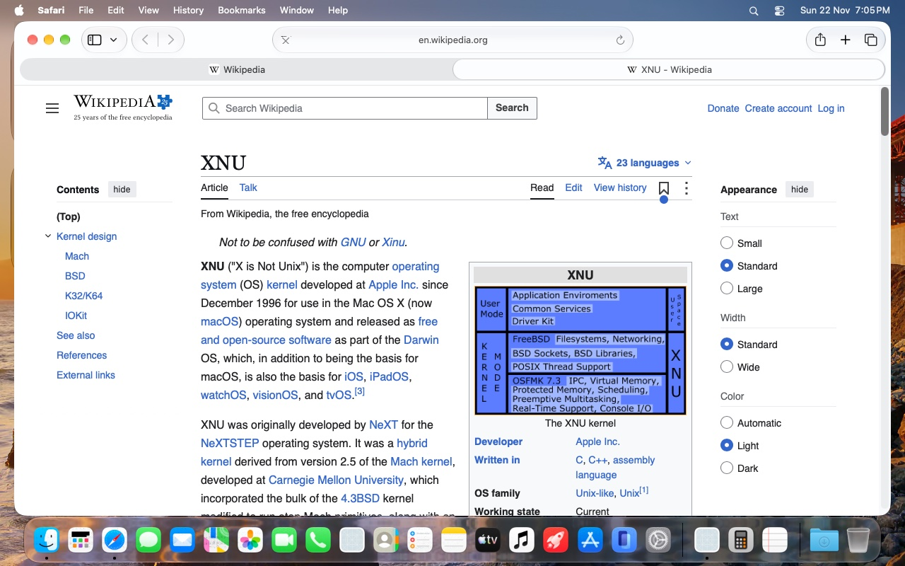
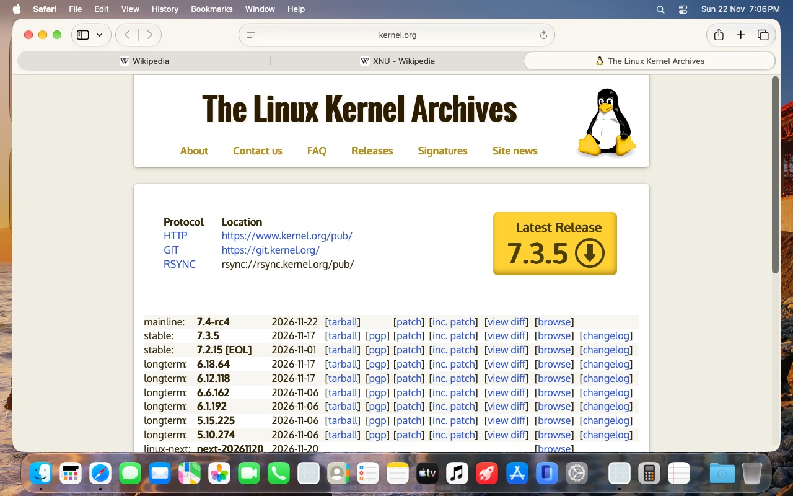
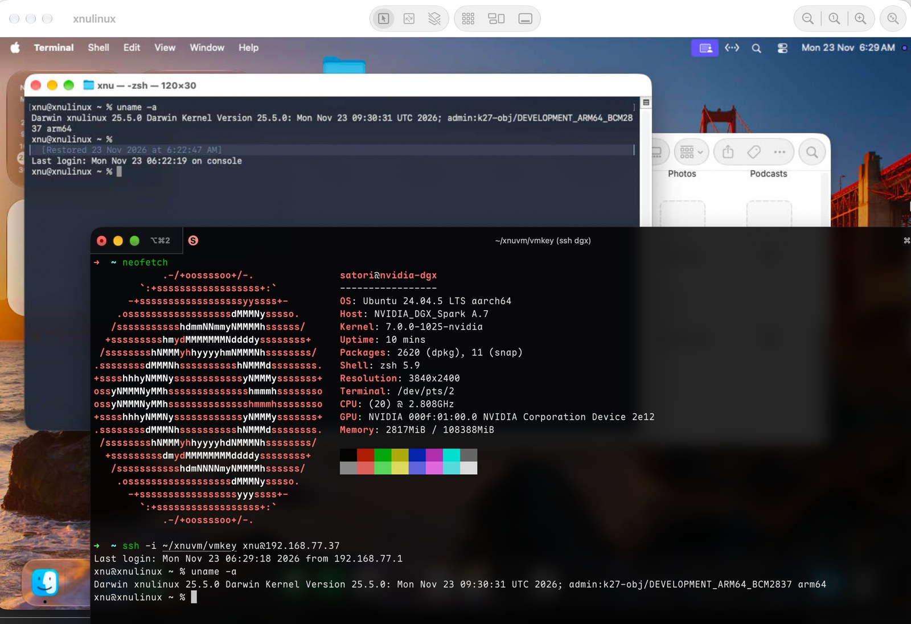
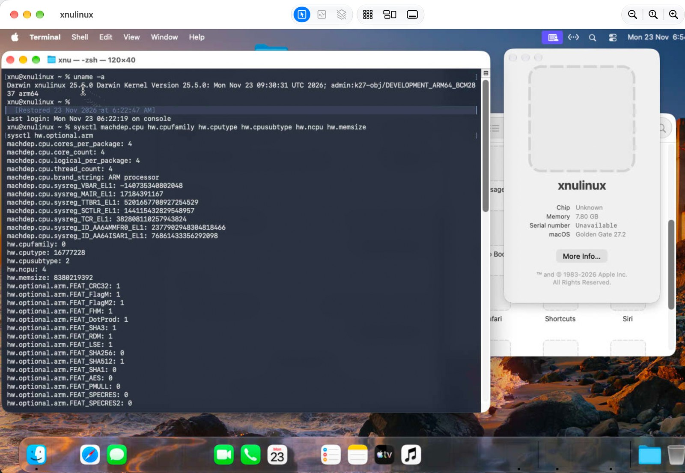

**Idiomas:** [English](README.md) | [Português](README.pt.md) 

# xnulinux

Rode o userspace do macOS no Linux carregando o kernel do macOS dentro dele.

O xnulinux compila o XNU, o kernel open-source do macOS, a partir de fontes publicadas pela Apple e o executa como um módulo carregável do kernel (xnu.ko) dentro de um kernel Linux arm64 sem modificações. O XNU hospedado controla a CPU e a MMU diretamente, fazendo com que os processos do macOS rodem de forma nativa lado a lado com os processos do Linux nas mesmas CPUs, sem nenhum hypervisor entre eles. O Linux empresta ao XNU sua memória, timers, arquivos, rede e GPU por meio de um pequeno módulo de interface (`fki.ko`).


Com um kernel stock do Ubuntu, o comando insmod xnu.ko inicializa um disco do sistema do macOS 27 gerado pelo próprio instalador da Apple diretamente ao desktop: loginwindow, WindowServer, Dock, Finder, Safari e Chrome.


*Um sistema, dois userspaces. À esquerda: um Terminal no macOS 27.2.1 hospedado (`sw_vers`, o kernel Darwin, launchd, WindowServer, Dock e Finder em execução). À direita: a partir desse macOS, uma sessão SSH conectada ao Linux dentro do qual ele roda (Ubuntu, Linux 7.0, os módulos `xnu` e `fki` carregados e o processo `insmod xnu.ko` no qual o kernel do macOS é executado). Diretamente do framebuffer hospedado, 1280×800.*


*O desktop hospedado ao final de uma stress run de 30 minutos, renderizado na CPU (sem GPU bridge).*

| | |
|---|---|
|  |  |
|  | |

*Safari no macOS hospedado: artigo da Wikipedia sobre o XNU, kernel.org e o repositório Linux no GitHub, via o link de rede do sistema hospedado através do Linux, com a ponte GPU ativada (`GPU=auto`).*



*NVIDIA DGX Spark no modo bare-metal (Ubuntu 24.04.5 LTS aarch64, Linux 7.0.0-1025-nvidia): macOS 27 hospedado rodando com 4 CPUs e 8 GiB de RAM (renderização via CPU), exibido através do macOS Screen Sharing ao lado de uma sessão SSH do host DGX Spark para o userspace Darwin hospedado.*



*Dentro do macOS hospedado no DGX Spark: Sobre Este Mac (`Chip: Unknown`, `7.80 GB` de memória, `macOS Golden Gate 27.2`) ao lado de `sysctl machdep.cpu` (`ARM processor`, `hw.cpufamily: 0`, `hw.ncpu: 4`) e `hw.optional.arm`.*

## Como funciona 

```
 Processos do macOS (launchd, WindowServer, Safari...)  Processos do Linux (systemd, sshd, xnudrmd...)
 ──────────────────────────────────────────────────    ────────────────────────────────────────────
XNU (compilado do código-fonte, camada LINUX64, kexts) │
   ↕ chamadas ao host linux64 (xnu-patches/include/linux64_abi.h)
 xnu.ko   (lado APSL: carrega e executa a kernel collection)
   ↕ FKI, a foreign kernel interface (fki_*)
 fki.ko   (lado GPL: CPUs, memória, faults, IPIs, arquivos, rede, host calls)
 Kernel Linux (kernel stock da distro, páginas 4K, PAC)
```

- **CPUs**: cada CPU hospedada é uma kernel thread do Linux fixada a uma CPU do Linux. O XNU roda nela até fazer uma chamada ao host (idle, I/O, um timer); o Linux mantém seus próprios exception vectors, e o `fki.ko` encaminha os faults e as exceções de usuário do código do XNU para os handlers do XNU.
- **Memória**: o XNU recebe um único bloco fisicamente contíguo do Linux (CMA) e o gerencia com seu próprio pmap; o XNU e o Linux compartilham a metade de usuário do layout do espaço de endereçamento (páginas de 4K).
- **Dispositivos**: as kexts em `kexts/` fornecem ao macOS um disco (um arquivo no lado do Linux), uma tela (um framebuffer que o Linux lê), um teclado e ponteiro, um link Ethernet (uma interface de rede do Linux), um keystore e uma GPU bridge.
- **GPU**: o Metal no macOS hospedado roda sobre o `gpu/xnu-cpu-metal` (metal2vulkan sob Vulkan). O Vulkan acessa a GPU do host Linux através da DRM bridge (`kexts/XnuDrm` → chamada ao host → `gpu/xnu-drm/xnudrmd` → o render node do Linux), usando o driver Venus do Mesa; sem um backend de DRM bridge compatível, ele faz fallback para o lavapipe do Mesa na CPU.

## Status

Funcionando em dois setups Linux arm64:

**Mac com Apple Silicon em uma VM Linux arm64 (`krunkit`, de 1 a 6 CPUs hospedadas)**:
- O macOS 27.2.1 inicializa até a área de trabalho com login automático em 31–48 s (uma VM macOS usando Apple Virtualization no mesmo Mac: 49 s).
- Os aplicativos abrem e fecham, o Spotlight e o sistema de arquivos funcionam; um teste de estresse de 30 minutos (40 rodadas de Safari, Notes, Calculator, TextEdit, System Settings, Spotlight e uma varredura de disco) termina sem nenhum panic e sem nenhum crash report.
- Roda como um serviço systemd: iniciado no boot, encerrado de forma limpa junto com a VM, reiniciado após um panic do kernel hospedado, com o log de cada execução mantido em `/var/log/xnulinux/`.
- A GPU bridge fornece aos aplicativos hospedados a GPU do host (`Virtio-GPU Venus (Apple M5 Max)`) e vem ativada por padrão (`GPU=auto`) quando um render node virtio-gpu está presente, fazendo fallback para renderização via CPU (`GPU=off`) caso contrário.
